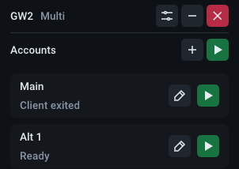
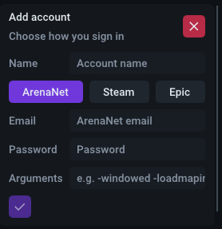
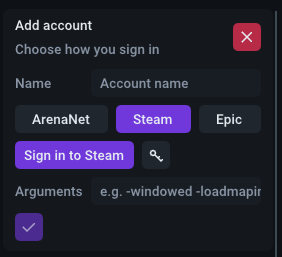
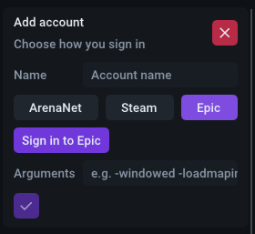
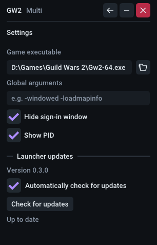

# GW2 Multi Launcher

Several Guild Wars 2 accounts. One copy of the game.

Launch one account, or all of them. Each account opens in its own window. Closing the launcher leaves the game open. Opening it again shows each game this launcher started that is still running. Starting the launcher while it is already open brings that window forward.

An account whose game is closed shows when it was last played, for example "Last played 3 h ago"; hover it for the date and time. A game you close after closing the launcher counts too.

An account's cross kills its game process immediately, including during startup
or sign-in. The double cross kills every game launched by this launcher and
cancels queued launches. Canceling account setup also kills that account's game.

<p align="center">
  
</p>

Add an account with Anet, Steam, or Epic. You sign in once, then just launch.

A Steam account gets Steam's overlay (Shift+Tab), controller support through
Steam Input and gem purchases with your Steam wallet when the Steam app is
signed in to that same Steam account. If the Steam app is closed and signs in to
that account by itself, the launcher starts it in the tray for you; a running
Steam is left as it is. The launcher still starts the game itself, so the
account's proxy keeps working. Without the Steam app, or with it signed in to
another account, the game starts as usual without them.

For the Chinese client, add a **KongZhong** account (your KongZhong login and
password), or a **WeGame** account if you play through WeGame. If you have both
clients, set the Chinese one under **Chinese client** in Settings; the account
editor offers the account types of the clients you have. A WeGame account
saves no login: keep WeGame open and signed in, and the launcher starts the game
through WeGame. WeGame runs one game at a time, and launch arguments and proxies
don't apply to it. The Chinese and global clients can run at the same time. Start
the WeGame game before your global ones: if WeGame goes offline or closes, it
closes the Guild Wars 2 that started first.

A game started while another one runs gets its own MumbleLink
(`GW2MultiLauncher-<account>`), so overlays such as Nexus don't mix the two up.
A game started alone keeps the default `MumbleLink` name, which Blish HUD reads.
WeGame games always use the default name. To pick the name yourself, add
`-mumble <name>` (for example `-mumble MumbleLink2`) to an account's arguments
or to the global arguments.

The launcher is in Chinese when the Chinese client is the only Guild Wars 2 it
finds, and in English when it finds the global client. It shows Chinese with
your system's Chinese font (Microsoft YaHei on Windows; Noto Sans CJK or
WenQuanYi on Linux).

Drag an account's header to reorder it. Release to save the order, or press Escape
to cancel.

If GW2 asks for a verification code, the waiting account expands into view. Enter
the code from your email, SMS, or authenticator app, then press Enter or click the
checkmark. Email prompts show which inbox to check. Verification automatically
enables GW2's **Remember network** option.

<p align="center">
  
  
  
</p>

The launcher looks for Guild Wars 2 when it first opens. One installation is
used right away and shown with **Change**; several ask you to pick one; none
offers **Find again** and **Browse for Gw2-64.exe**. If the game later moves, the
launch that found the problem shows the same choices in place: **Use and launch**
saves the new location and continues that launch once, and **Cancel** launches
nothing. Settings has the same controls.

**Launch GW2** starts the game without adding an account: sign in through GW2,
which uses your remembered login if available. It keeps the sign-in window
visible, uses your global arguments and DLLs, and stays available after you add
accounts as a **Guild Wars 2** row above them. While it runs, that row shows
**Show game** and the kill cross like an account; clicking
**Launch GW2** again shows that game instead of starting another. If you do not use
that row, enable **Hide Guild Wars 2 row** in Settings; it still appears while that
game runs or needs attention.

When you launch, the launcher checks for GW2 updates. If no GW2 clients are running, it installs any
required update automatically, then launches your account. If an update is needed
while GW2 is running, close all GW2 windows and launch again. If GW2 releases an
update while an account is starting, the launcher closes that client, installs the
update, and launches the account again.

Enable **Always on top** in Settings to keep the launcher above other windows.
The setting applies immediately and is remembered between sessions.

Enable **Minimize when the game starts** in Settings to minimize the launcher once
the games you launched are running. It stays open while a launch still needs you,
such as for a verification code.

The first time the launcher opens, it asks whether to check for updates
automatically. That check stays off until you choose yes. The choice is remembered.

To load DLLs into the game, use the **DLLs** folder button in Settings or an account's
editor. DLLs selected in Settings load first, followed by that account's DLLs;
duplicate files load once. Click a file's tag to replace it or its cross to remove
it. Changes apply on the next launch. An account the launcher signs in loads them
once the game window opens, so signing in never waits for them; the normal GW2
launch loads them at its login screen, and finishes at the game window if you press
Play before they are done.

Each game loads a temporary copy of the selected DLL, keeping the original
filename so add-ons can still find it by name. You can rebuild or replace the
source DLL while playing. The launcher keeps the newest copy of each DLL so the
next launch loads it without another antivirus scan, and removes older copies
once no game is using them.

On Windows, **Programs** starts other tools, such as Blish HUD, when you launch a
game. Programs chosen in Settings start with every launch; an account's own programs
start when that account launches. A program that is already running is not started
again, and programs
keep running when you close the launcher. They run with the launcher's rights, the
same as the game, so overlays that read your key presses see them.

Each program has a delay in seconds beside its name, up to 600. It waits that long
after the previous program before starting; with 0 it starts right away. Drag the
delay or double-click it to type. A delayed program is not started if its game has
exited, failed, or been cancelled, or if you close the launcher first.

<p align="center">
  
</p>

## Install

- **Windows 10/11:** download the setup from [Releases](https://github.com/Dvow/gw2-multi-launcher/releases).
- **Ubuntu 26.04:** install the `.deb` from that page with `sudo apt install ./gw2-multi-launcher_*_amd64.deb`. The first-run card asks for the Wine or Proton runner, prefix, or Proton folder when it cannot find them; Settings shows them all.

Accounts and settings are stored in `%APPDATA%\GW2 Multi Launcher` on Windows
(Roaming AppData), or `$XDG_DATA_HOME/GW2 Multi Launcher` on Linux (normally
`~/.local/share/GW2 Multi Launcher`). Only this folder is used. If it has no
settings, the launcher starts fresh; older locations and settings formats are
not imported.

Windows Setup selects **Create a desktop shortcut** by default. Silent launcher
updates do not create desktop shortcuts. Shortcuts use the installer's current
product name and ID.

Not an official ArenaNet app. Two-factor still works like a normal login.

<details>
<summary>Build</summary>

CMake 3.30+ and Ninja. Windows also needs MSVC x64 and Windows SDK 10.0.26100 or newer.

```sh
cmake --preset run-debug
cmake --build --preset run-debug
```

In Visual Studio, open the folder, choose **Debug**, select the startup item `GW2MultiLauncher.exe`, and press F5. Choose **Release** for an optimized local build. Both choices build the launcher and its required game helpers, without tests or installer preparation. Each uses its own `build/run-debug` or `build/run-release` directory.

Use **Show/Hide Debug Targets** once to leave only the launcher visible. Visual Studio remembers startup choices locally. When migrating from an older preset, select Debug and the launcher once; existing build directories and workspace settings can remain.

For tests and packaging, enable advanced builds in the current shell and use the existing Public Release preset:

```powershell
$env:KX_ADVANCED_BUILDS = '1'
cmake --preset release
cmake --build --preset release
ctest --preset release
```

On Linux, use `export KX_ADVANCED_BUILDS=1`. To see advanced choices in Visual Studio, launch the IDE from that shell. CI enables them automatically. There is one build preset per configuration; for an advanced launcher-only build, use `cmake --build build/release --target gw2-multi-launcher`.

SDL, Dear ImGui, nlohmann/json, MinHook, zlib, and the QR Code generator come from hashed archives through CPM. They are stored in `.cpm` next to the source tree and reused by every build directory. Set `CPM_SOURCE_CACHE` to use another directory.

The advanced Public Release installer is written to `build/release`; daily Release does not create an installer. On Windows, regular PowerShell works when the MSVC x64 and Windows SDK build environment is configured. Visual Studio's Developer PowerShell is one way to set that up; you do not need to switch terminals if your current session already builds successfully.

Advanced Windows configure downloads Inno Setup 7.1.0 into `build/tools/Inno Setup 7` when `ISCC.exe` is not already available. That folder is ignored by Git. To select another compiler, configure with `cmake --preset release -DGW2_ISCC="C:/path/to/Inno Setup/ISCC.exe"`.

On Ubuntu, install `g++ cmake ninja-build pkg-config dpkg-dev libsecret-1-dev libssl-dev libcurl4-openssl-dev libgl-dev libx11-dev libxext-dev libxcursor-dev libxrandr-dev libxi-dev libxfixes-dev libxss-dev libxtst-dev`, then configure with `-DCMAKE_INSTALL_PREFIX=/usr -DGW2_NATIVE_DIR=/path/to/matching/windows/bin`.

MIT licensed.

</details>

## Per-account proxies

Accounts can optionally route their GW2 process through separate SOCKS5 or HTTP/HTTPS CONNECT proxies on Windows. See [proxy setup and behavior](proxy.md).

The launcher's own requests (sign-in, update checks, downloads) are separate from that. On Windows they use the proxy server or setup script entered in Windows' proxy settings, and connect directly when neither is set. **Automatically detect settings** alone is not followed: a network whose detected script names a proxy that does not answer would block every request, although the game itself connects directly.
